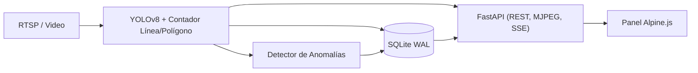

# Gas Cylinder Vision

[](https://fastapi.tiangolo.com)
[](https://www.python.org/)
[](https://ultralytics.com)
[](https://alpinejs.dev/)
[](https://tailwindcss.com/)
[](https://daisyui.com/)
[](https://www.docker.com/)
[](https://docs.pytest.org/)

[English](README.md) | Español

**Gas Cylinder Vision** es un servicio web y panel de Visión Artificial en tiempo real para contar cilindros de gas y detectar discrepancias de inventario desde cámaras RTSP en vivo o videos grabados.

---

## Características Principales

- **Detección y Conteo en Tiempo Real**: Rastrea cilindros con YOLOv8 y OpenCV mediante líneas direccionales o zonas poligonales, con aceleración automática por GPU CUDA y respaldo en CPU.
- **Detección de Anomalías**: Compara entradas (IN) y salidas (OUT) en una ventana deslizante de tiempo y genera alertas (`OVER_EXIT` / `UNDER_EXIT`) cuando hay inconsistencias.
- **Streaming y Telemetría en Vivo**: Transmite video MJPEG (`/video_feed`) y eventos Server-Sent Events (`/api/status/stream`) hacia un panel web bilingüe (ES/EN) con Alpine.js.
- **Registro Persistente**: Guarda totales diarios, eventos de cruce y alertas en SQLite (modo WAL).
- **Seguridad para Producción**: Incluye autenticación HTTP Basic, límite de intentos por IP, ocultamiento de credenciales RTSP y cabeceras de seguridad (`CSP`, `X-Frame-Options`, `HSTS`).

---

## Arquitectura y Stack



| Área | Stack |
| :--- | :--- |
| **Backend** | Python 3.10+, FastAPI, Uvicorn, Pydantic v2 |
| **Visión Artificial** | Ultralytics YOLOv8, PyTorch (CUDA / CPU), OpenCV |
| **Base de Datos** | SQLite (modo WAL) |
| **Frontend** | Alpine.js, Tailwind CSS, DaisyUI (sin dependencias externas en runtime) |
| **Pruebas y Despliegue** | Pytest, `httpx`, Docker, Docker Compose |

---

## Estructura del Proyecto

```text
gas_stream/
├── app/
│   ├── api/v1/endpoints/   # REST, stream MJPEG, telemetría SSE, conteos y alertas
│   ├── core/               # Configuración (.env + config.json), auth, logs e i18n
│   ├── cv/                 # Captura de video, detector YOLOv8, contador y renderizado
│   ├── db/                 # Gestor de conexiones SQLite y repositorio
│   ├── services/           # Worker de streaming y detector de anomalías
│   └── main.py             # Fábrica FastAPI y middleware de seguridad
├── locales/                # Traducciones en español e inglés
├── models/                 # Pesos del modelo YOLO (.pt)
├── static/ & templates/    # Recursos del panel web
├── tests/                  # Pruebas unitarias y de integración API
└── Dockerfile / docker-compose.yml
```

---

## Inicio Rápido

### Local (Python 3.10+)

```bash
# 1. Crear y activar entorno virtual
python -m venv venv
# Windows PowerShell: .\venv\Scripts\Activate.ps1
# Linux / macOS:      source venv/bin/activate

# 2. Instalar dependencias
pip install -r requirements.txt

# 3. Iniciar el servidor
python -m uvicorn app.main:app --host 0.0.0.0 --port 8000 --reload
```

Accesos disponibles:
- **Panel Web**: [http://localhost:8000](http://localhost:8000)
- **Swagger Docs**: [http://localhost:8000/docs](http://localhost:8000/docs)
- **ReDoc**: [http://localhost:8000/redoc](http://localhost:8000/redoc)
- **Health Check**: `GET /health`

### Docker

```bash
docker compose up --build -d
```

### Configuración y GPU (Opcional)

Copia `.env.example` a `.env` para personalizar variables de entorno:
- `YOLO_DEVICE=auto` (`auto`, `cuda` o `cpu`)
- `ADMIN_USERNAME` / `ADMIN_PASSWORD` (`admin:admin` se bloquea automáticamente si `ENVIRONMENT=production`)
- `CAMERA_URL` (URL RTSP opcional de cámara IP)

Para aceleración con GPU NVIDIA (CUDA 12.4):
```bash
pip install torch torchvision --index-url https://download.pytorch.org/whl/cu124 --force-reinstall
```

---

## Pruebas

```bash
python -m pytest                 # Suite completa
python -m pytest -m unit         # Pruebas unitarias
python -m pytest -m integration  # Pruebas de integración API
```
