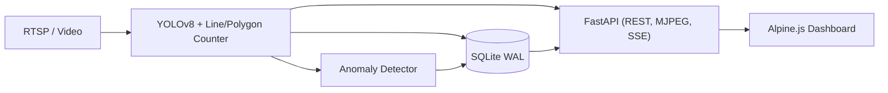

# Gas Cylinder Vision

[](https://fastapi.tiangolo.com)
[](https://www.python.org/)
[](https://ultralytics.com)
[](https://alpinejs.dev/)
[](https://tailwindcss.com/)
[](https://daisyui.com/)
[](https://www.docker.com/)
[](https://docs.pytest.org/)

English | [Español](README.es.md)

**Gas Cylinder Vision** is a real-time Computer Vision web service and dashboard for counting gas cylinders and detecting inventory discrepancies from live RTSP cameras or recorded video.

---

## Key Features

- **Real-Time Detection & Counting**: Tracks gas cylinders with YOLOv8 and OpenCV across directional lines or polygon zones, with automatic CUDA GPU acceleration and CPU fallback.
- **Anomaly Detection**: Monitors IN vs. OUT cylinder batches over a sliding time window and raises alerts (`OVER_EXIT` / `UNDER_EXIT`) when counts do not match.
- **Live Streaming & Telemetry**: Serves low-latency MJPEG video (`/video_feed`) and Server-Sent Events (`/api/status/stream`) to a bilingual (EN/ES) Alpine.js dashboard.
- **Persistent Audit Log**: Saves daily totals, individual crossing events, and alerts in SQLite (WAL mode).
- **Production Security**: Includes HTTP Basic Auth, IP brute-force rate limiting, RTSP credential masking, and strict security headers (`CSP`, `X-Frame-Options`, `HSTS`).

---

## Architecture & Tech Stack



| Area | Stack |
| :--- | :--- |
| **Backend** | Python 3.10+, FastAPI, Uvicorn, Pydantic v2 |
| **Computer Vision** | Ultralytics YOLOv8, PyTorch (CUDA / CPU), OpenCV |
| **Database** | SQLite (WAL mode) |
| **Frontend** | Alpine.js, Tailwind CSS, DaisyUI (offline-ready) |
| **Testing & Deploy** | Pytest, `httpx`, Docker, Docker Compose |

---

## Project Structure

```text
gas_stream/
├── app/
│   ├── api/v1/endpoints/   # REST, MJPEG stream, SSE telemetry, counts & alerts
│   ├── core/               # Config (.env + config.json), auth, logging, i18n
│   ├── cv/                 # Video capture, YOLOv8 detector, counter, renderer
│   ├── db/                 # SQLite connection manager and repository
│   ├── services/           # Stream worker and sliding-window anomaly detector
│   └── main.py             # FastAPI app factory and security middleware
├── locales/                # English and Spanish translations
├── models/                 # YOLO weights (.pt)
├── static/ & templates/    # Dashboard UI assets
├── tests/                  # Unit and API integration tests
└── Dockerfile / docker-compose.yml
```

---

## Quick Start

### Local (Python 3.10+)

```bash
# 1. Create and activate a virtual environment
python -m venv venv
# Windows PowerShell: .\venv\Scripts\Activate.ps1
# Linux / macOS:      source venv/bin/activate

# 2. Install dependencies
pip install -r requirements.txt

# 3. Start the server
python -m uvicorn app.main:app --host 0.0.0.0 --port 8000 --reload
```

Open the app in your browser:
- **Dashboard**: [http://localhost:8000](http://localhost:8000)
- **Swagger Docs**: [http://localhost:8000/docs](http://localhost:8000/docs)
- **ReDoc**: [http://localhost:8000/redoc](http://localhost:8000/redoc)
- **Health Check**: `GET /health`

### Docker

```bash
docker compose up --build -d
```

### Configuration & GPU (Optional)

Copy `.env.example` to `.env` to override defaults:
- `YOLO_DEVICE=auto` (`auto`, `cuda`, or `cpu`)
- `ADMIN_USERNAME` / `ADMIN_PASSWORD` (default `admin:admin` is blocked when `ENVIRONMENT=production`)
- `CAMERA_URL` (optional RTSP stream URL)

For NVIDIA GPU acceleration (CUDA 12.4):
```bash
pip install torch torchvision --index-url https://download.pytorch.org/whl/cu124 --force-reinstall
```

---

## Tests

```bash
python -m pytest                 # Full suite
python -m pytest -m unit         # Unit tests
python -m pytest -m integration  # API integration tests
```
